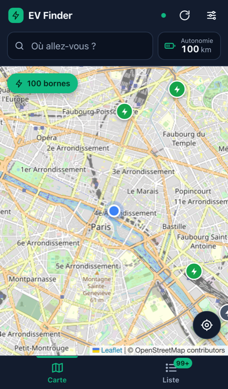

# EV Finder

[](https://github.com/didlawowo/ev-charge-tracker/actions/workflows/ci.yml)
[](LICENSE)
[](https://github.com/didlawowo/ev-charge-tracker/releases)

Application web (PWA) mobile-first pour trouver les bornes de recharge rapide
**CCS** le long d'un trajet et planifier les arrêts de recharge.

> Stack : **Vue 3** (Composition API) · **Vite** · **Leaflet** · **Workbox** (PWA).
> Données via des APIs publiques : OpenChargeMap, OSRM, Photon, OpenStreetMap.

## Aperçu



## Fonctionnalités

### Carte et recherche de bornes

- Bornes affichées sur une carte interactive (Leaflet + OpenStreetMap), avec
  position GPS en temps réel.
- Marqueurs dont la taille s'adapte au zoom pour ne pas masquer l'itinéraire.
- Rafraîchissement des bornes autour de soi ou le long du trajet.
- Lien vers la fiche détaillée de la borne sur OpenChargeMap.

### Réglages (menu Options)

- Autonomie maximale du véhicule.
- Été / hiver : consommation 19 vs 25 kWh/100 km (−24 % d'autonomie en hiver).
- Aller simple / aller-retour.
- CCS uniquement, exclusion des Superchargeurs Tesla.
- « Sur ma route » : couloir de 5 km autour du tracé.
- Puissance minimale (tout / 50 / 100 / 150 / 300 kW, défaut 100 kW).
- Rayon de recherche hors trajet (5–100 km).

### Planification de trajet

- Recherche de destination avec autocomplétion (Photon / OpenStreetMap).
- Calcul d'itinéraire et itinéraires alternatifs (OSRM).
- Autonomie restante éditable à côté de la destination (saisie, ±10 km,
  curseur, raccourcis 20/50/80/100 %).
- **Arrêts de recharge recommandés** : algorithme glouton qui minimise le nombre
  d'arrêts (recharge cible 80 %, marge de sécurité 10 %). Chaque arrêt est
  cliquable pour le centrer sur la carte.
- Envoi vers une application de navigation : Google Maps (départ → borne →
  destination, la borne en point de passage) et Apple Plans (itinéraire vers la
  borne ; Apple ne gère pas les points de passage par URL).

### PWA / hors-ligne

- Installable sur mobile.
- **Dernier trajet mémorisé** sur l'appareil (itinéraire, arrêts, bornes) :
  réaffiché automatiquement hors ligne ou via « Reprendre le dernier trajet ».
- Cache Workbox : réponses d'API en `NetworkFirst`, tuiles de carte déjà
  affichées en `CacheFirst` (7 jours). Le pré-téléchargement de tuiles est
  volontairement absent : il est interdit par la
  [politique d'usage des tuiles OSM](https://operations.osmfoundation.org/policies/tiles/).

## Démarrage

Prérequis : Node.js ≥ 20.

```bash
git clone https://github.com/didlawowo/ev-charge-tracker.git
cd ev-charge-tracker
npm install
cp .env.example .env   # puis renseignez VITE_OPENCHARGE_API_KEY
npm run dev
```

L'application est servie sur <http://localhost:5173>.

### Configuration

Une clé API OpenChargeMap (gratuite) est nécessaire. Créez-la sur
[openchargemap.org/site/develop/api](https://openchargemap.org/site/develop/api),
puis dans `.env` :

```env
VITE_OPENCHARGE_API_KEY=your_openchargemap_api_key_here
```

> **Note** : l'application est purement côté client. Les variables `VITE_*` sont
> intégrées au bundle au build et donc **publiques** sur le site déployé. Les
> clés OpenChargeMap sont gratuites et à faible risque ; utilisez une clé dédiée
> à votre déploiement et faites-la tourner si besoin.

### Tests

```bash
npx playwright install --with-deps chromium
npm run test
```

Les tests end-to-end Playwright démarrent automatiquement le build de production
sur le port 4173.

## Scripts

| Commande | Rôle |
| --- | --- |
| `npm run dev` | Serveur de développement avec HMR |
| `npm run build` | Build de production dans `dist/` |
| `npm run preview` | Prévisualisation du build |
| `npm run lint` | ESLint sur `src/` |
| `npm run test` | Tests Playwright |

Les mêmes commandes existent via [Task](https://taskfile.dev) (`task lint`,
`task build`, `task test`, `task ci`).

## Déploiement

Le build produit un site statique dans `dist/`. `netlify.toml` fournit une
configuration prête à l'emploi (build `npm run build`, publication `dist/`,
redirection SPA vers `/index.html`) ; tout hébergeur statique capable de servir
une SPA convient.

La clé `VITE_OPENCHARGE_API_KEY` se définit dans les variables d'environnement de
la plateforme d'hébergement, jamais dans le dépôt. Les releases publiées par la
CI contiennent le build compilé (`dist.zip`).

## APIs utilisées

| Service | Usage | Cache |
| --- | --- | --- |
| [OpenChargeMap](https://openchargemap.org) | Données des bornes | 5 min |
| [OpenStreetMap](https://www.openstreetmap.org) | Tuiles de carte (vues) | 7 jours |
| [OSRM](https://project-osrm.org) | Calcul d'itinéraire | 1 heure |
| [Photon (Komoot)](https://photon.komoot.io) | Autocomplétion d'adresses | 1 jour |

Ces services publics sont soumis à leurs propres conditions d'utilisation ; le
projet n'y est pas affilié.

## Architecture

Voir [`AGENTS.md`](./AGENTS.md) pour le détail : composables, flux de données et
notes d'implémentation de l'algorithme de planification.

## Contribuer

Les contributions sont bienvenues — voir [`CONTRIBUTING.md`](./CONTRIBUTING.md)
et le [`CODE_OF_CONDUCT.md`](./CODE_OF_CONDUCT.md). Pour les problèmes de
sécurité, utilisez [SECURITY.md](./SECURITY.md).

## Licence

[MIT](./LICENSE) © didlawowo
